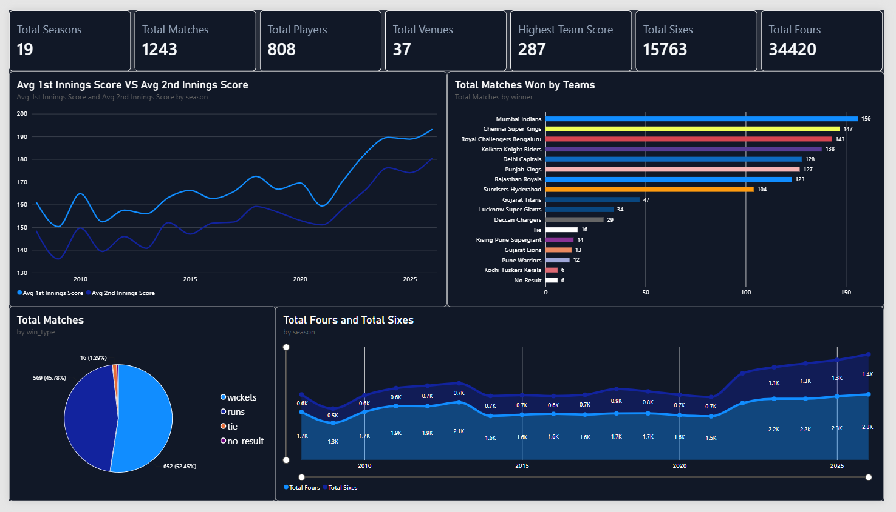
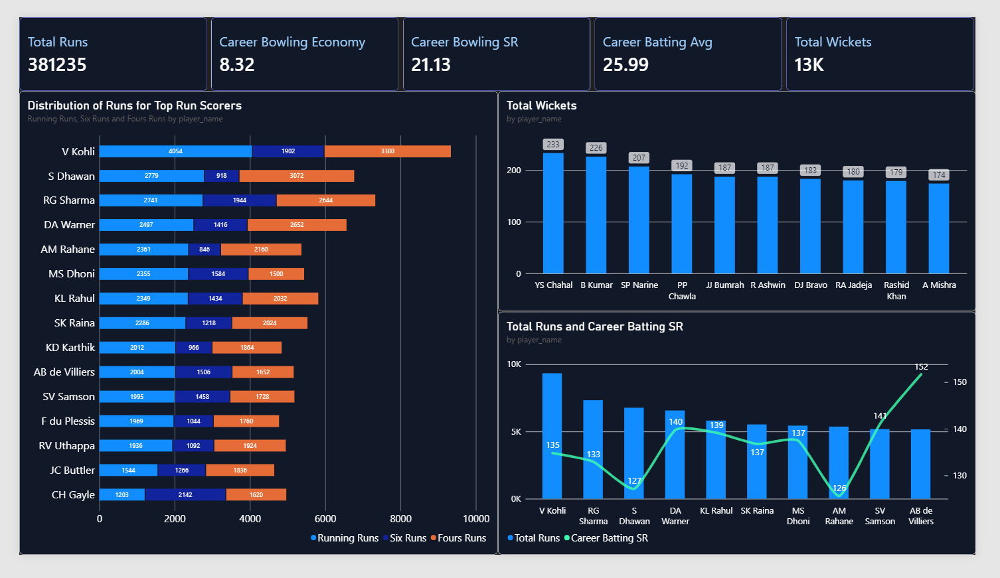
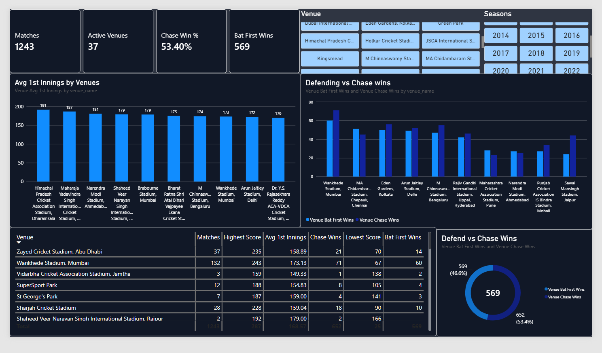
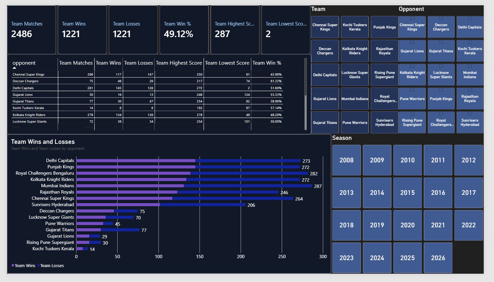
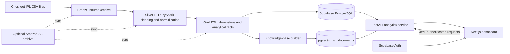
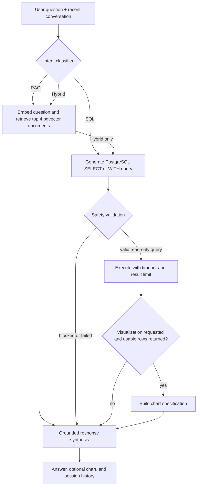
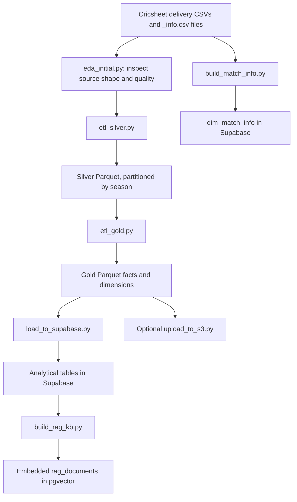

<div align="center">
  <h1>Know IPL</h1>
  
  <p><strong>A full-stack IPL intelligence platform for historical analytics, data exploration, and AI-assisted research.</strong></p>
  <p>
    <a href="#quick-start">Quick start</a> ·
    <a href="#architecture">Architecture</a> ·
    <a href="#data-pipeline">Data pipeline</a> ·
    <a href="#api-reference">API</a> ·
    <a href="#security">Security</a>
  </p>
</div>

## Overview

Know IPL transforms ball-by-ball Indian Premier League data into a query-ready analytical warehouse and an authenticated dashboard. It combines interactive visualizations, statistical analysis, and `cricketmama.exe`—an AI assistant that can retrieve cricket knowledge, safely query the warehouse, and return chart-ready results.

The loaded historical coverage is determined by the Cricsheet IPL CSV files supplied to the pipeline. The application and its analytics are designed around seasons from 2008 onward.

### Power BI research reference

This application extends the exploratory work in [IPL Data Analysis](https://github.com/ritam-05/ipl-data-analysis). The Power BI dashboards below are historical design and analysis references; Know IPL turns that work into an interactive Next.js and FastAPI product backed by a reproducible data warehouse.

<p align="center">
  
  
</p>
<p align="center">
  
  
</p>

## What it delivers

- **Interactive analytics** for seasons, players, teams, head-to-head records, venues, match extremes, and win outcomes.
- **A layered data platform** that moves raw CSV into cleaned, partitioned Parquet and curated Gold dimensions and facts.
- **Research-grade metrics** including batting and bowling aggregates, player consistency, chasing advantage, and scoring-era tests.
- **An AI analyst** that classifies questions as retrieval, SQL, or hybrid; answers with grounded context; and emits chart specifications when data supports a visualization.
- **Authenticated personalization** through Supabase Auth: user preferences, saved analyses, and a rolling three-session chat history.
- **Defensive AI database access** with read-only SQL validation, forbidden-keyword screening, a 5-second statement timeout, and result limits.

## Technology

| Area | Tools |
| --- | --- |
| Web application | Next.js 16, React 19, TypeScript, Tailwind CSS, Recharts |
| API | Python, FastAPI, Uvicorn, SQLAlchemy |
| Data engineering | PySpark, Pandas, PyArrow |
| Data platform | Supabase PostgreSQL, pgvector, Row Level Security |
| AI | LangGraph, LangChain Groq, BAAI `bge-small-en-v1.5` embeddings |
| Storage | Local Bronze/Silver/Gold layers with optional Amazon S3 synchronization |

## Architecture

The platform separates data preparation, analytical storage, API delivery, and browser experience. Raw match events are transformed once, loaded into a relational analytical model, and then reused by both the dashboard and the AI assistant.



```text
Cricsheet IPL CSVs
       │
       ▼
Bronze ──► Silver (PySpark cleaning + partitioned Parquet) ──► Gold facts & dimensions
                                                                  │
                                                 ┌────────────────┴────────────────┐
                                                 ▼                                 ▼
                                  Supabase PostgreSQL + RLS                 pgvector knowledge base
                                                 │                                 │
                                                 └──────────────┬──────────────────┘
                                                                ▼
                                                FastAPI analytics & AI service
                                                                │
                                                                ▼
                                  Next.js dashboard + Supabase Auth + Recharts
```

### AI request flow

```text
Question → Intent classification → RAG retrieval and/or Text-to-SQL → SQL safety gate
         → chart specification (when applicable) → grounded response
```

The assistant routes conceptual questions to vector retrieval, numerical questions to Text-to-SQL, and mixed questions through both paths. Generated SQL must be one `SELECT` or `WITH` statement; write operations and multi-statement queries are rejected.

### Assistant decision flow



## Repository structure

```text
.
├── backend/
│   ├── main.py                       # FastAPI application and CORS configuration
│   └── app/
│       ├── agents/ipl_agent.py       # LangGraph RAG / Text-to-SQL workflow
│       ├── api/                      # Analytics, chat, profile, and saved-analysis routes
│       ├── core/auth.py              # Supabase JWT validation and server client
│       └── services/analytics.py     # SQL-backed metrics and statistical tests
├── data-engineering/
│   ├── etl_silver.py                 # Raw delivery CSV → normalized Silver Parquet
│   ├── etl_gold.py                   # Silver data → eight analytical Gold tables
│   ├── load_to_supabase.py           # Idempotent Gold-table load to PostgreSQL
│   ├── build_match_info.py           # Metadata CSV → dim_match_info
│   ├── build_rag_kb.py               # Grounded documents and 384-dim embeddings
│   ├── upload_to_s3.py               # Optional data-lake synchronization
│   └── verify_*.py                   # Analytics and agent smoke checks
├── frontend/                         # Next.js application
├── supabase/migrations/              # PostgreSQL schema, indexes, pgvector, and RLS
└── requirements.txt                  # Python dependencies
```

## Quick start

### Prerequisites

- Python 3.11 or later
- Node.js 20 or later
- Java 17 or later for local PySpark jobs
- A Supabase project with email authentication enabled
- A Groq API key for `cricketmama.exe`
- Cricsheet IPL CSV data for a first-time warehouse build

### 1. Install dependencies

```powershell
# From the repository root
python -m venv .venv
.\.venv\Scripts\Activate.ps1
pip install -r requirements.txt

cd frontend
npm install
cd ..
```

### 2. Configure environment variables

Create a root `.env` file for the API, ETL jobs, and agent:

```env
# Required server-side Supabase configuration
SUPABASE_URL=https://your-project-ref.supabase.co
SUPABASE_SECRET_KEY=your-supabase-secret-key
SUPABASE_DB_URL=postgresql+psycopg://...

# Required for the AI assistant
GROQ_API_KEY=your-groq-api-key
GROQ_MODEL=openai/gpt-oss-120b

# Optional API configuration
CORS_ORIGINS=http://localhost:3000,http://127.0.0.1:3000
PORT=7860

# Optional S3 archival
AWS_S3_BUCKET=your-bucket-name
AWS_REGION=ap-south-1
```

Create `frontend/.env.local` with browser-safe values only:

```env
NEXT_PUBLIC_SUPABASE_URL=https://your-project-ref.supabase.co
NEXT_PUBLIC_SUPABASE_PUBLISHABLE_KEY=your-supabase-publishable-key
NEXT_PUBLIC_API_URL=http://127.0.0.1:7860
```

> Never put `SUPABASE_SECRET_KEY`, `SUPABASE_DB_URL`, or `GROQ_API_KEY` in a `NEXT_PUBLIC_*` variable or frontend environment file.

### 3. Provision the database

Run [001_initial_schema.sql](supabase/migrations/001_initial_schema.sql) in the Supabase SQL Editor. It enables pgvector and creates the analytical tables, vector store, user-data tables, indexes, and row-level security policies.

### 4. Build and load the warehouse

Extract the Cricsheet IPL CSV files into `data-engineering/bronze/cricsheet_raw/`. Both numeric match-delivery files and their matching `_info.csv` files are required for the complete model.

```powershell
# Optional source inspection
python data-engineering/eda_initial.py

# Required warehouse build and load
python data-engineering/etl_silver.py
python data-engineering/etl_gold.py
python data-engineering/load_to_supabase.py
python data-engineering/build_match_info.py
python data-engineering/build_rag_kb.py
```

`load_to_supabase.py` refreshes the eight Gold analytical tables. `build_match_info.py` separately loads supplementary match metadata such as tosses, umpires, player of the match, stage, and venue city.

### 5. Run the application

Start the backend from the repository root:

```powershell
.\.venv\Scripts\Activate.ps1
python -m uvicorn backend.main:app --reload --port 7860
```

In a second terminal, start the dashboard:

```powershell
cd frontend
npm run dev
```

Open [http://localhost:3000](http://localhost:3000). The interactive API reference is available at [http://127.0.0.1:7860/docs](http://127.0.0.1:7860/docs).

## Product areas

| Area | Capabilities |
| --- | --- |
| Overview | Scoring trends, franchise wins, match-outcome distribution, boundaries, and statistical findings |
| Players | Searchable directory, seasonal filters, batting and bowling leaderboards, consistency analysis |
| Teams | Franchise standings, details, season filters, and head-to-head comparison |
| Venues | First-innings scoring, defend-versus-chase outcomes, and venue summaries |
| Seasons | Season scorecards, highest combined-score matches, and closest run-margin finishes |
| AI assistant | Multi-session question answering, SQL visibility, dynamic charts, and saved analyses |
| Settings | Display name, favourite team, and favourite player preferences that personalize AI context |

## Website guide

Every analytics screen calls the FastAPI service rather than embedding a static export. Filters, search terms, and selected franchises are therefore applied to the warehouse-backed data returned by the API.

### Overview (`/`)

The landing dashboard provides the quickest read of the competition: headline counts for seasons, matches, players, teams, venues, average first-innings score, and highest team score; two statistically tested findings; and four complementary charts.

| Chart | What it shows | How to read it |
| --- | --- | --- |
| **Average 1st innings vs average 2nd innings** | Two season-by-season scoring series. | Compare the lines to see whether first-innings scoring and chase scoring are moving together or apart. |
| **Total matches won by teams** | All-time wins for each franchise. | The horizontal ranking highlights volume of success; it is not a win-rate comparison. |
| **Match outcomes** | Donut split of wins by wickets, wins by runs, ties/super overs, and no results. | It gives a high-level view of the relative frequency of chasing and defending outcomes. |
| **Total fours and total sixes** | Boundary totals by season. | Use the two trend lines to see how the scoring mix has evolved. |

The statistical cards report the chase-win percentage with an exact binomial test and the difference between the 2008–2017 and 2018–2026 first-innings scoring eras with Welch’s t-test. They should be interpreted with their displayed p-values rather than as causal claims.

### Player analytics (`/players`)

This page has batting, bowling, consistency, and complete-directory tabs. Search applies across the active view, while the season selector changes batting, bowling, and directory results. The directory is paginated and combines batting and bowling career fields in one searchable table.

| Chart | What it shows | How to read it |
| --- | --- | --- |
| **Most consistent batters** | Lowest coefficient of variation (CV) among qualifying multi-season run scorers. | Lower CV means less season-to-season variation in run production; it is not a measure of peak output. |
| **Distribution of runs for top run scorers** | Stacked running runs, runs from fours, and runs from sixes. | Reveals how leading batters accumulated their runs, separating boundary value from other scoring. |
| **Total wickets** | Wickets for the leading bowlers in the current filter. | A volume comparison; consult the table for economy, average, and strike rate. |
| **Total runs and career batting strike rate** | Bars for career runs and a second-axis line for strike rate. | Use the two axes to compare longevity/volume with scoring pace without treating their scales as interchangeable. |

The accompanying tables expose matches, runs, averages, strike rates, boundaries, high score, wickets, overs, economy, bowling average, and bowling strike rate. A dash represents a metric that is undefined rather than zero—for example, a batting average with no dismissals.

### Team analytics (`/teams`)

Choose an all-time or individual season view, then select any two teams in the **Head-to-Head Rivalry Comparator**. It returns their meeting count, wins for each side, and ties/no-results. The **Win Percentage by Franchise** bar chart is the rate-based counterpart to the overview’s all-time win total; the standings table adds matches, wins, and batting-first/chasing win splits. Selecting a standings row opens a deeper franchise summary, including its season record and the detailed matchup context.

### Venue analytics (`/venues`)

Venue results are designed to separate scoring environment from match-result tendency.

| Chart | What it shows | How to read it |
| --- | --- | --- |
| **Average 1st innings by venue** | Top qualifying venues ranked by average first-innings score. | A higher bar signals historical scoring conditions, not a guaranteed par score for a future match. |
| **Defending vs chase wins by venue** | Grouped bars for wins batting first and wins while chasing. | Compare bar pairs for the venues shown; sample size remains important. |
| **Defend vs chase wins** | Donut chart aggregating those two outcomes across the filtered venues. | Summarizes the overall tactical balance of the displayed venue set. |

The venue table provides total matches, first-innings average and extremes, both win counts, and chase-win percentage so that the charted patterns can be checked against their underlying sample.

### Season and match analytics (`/seasons`)

The season selector controls the **Matches by Season** bar chart, which provides a quick view of schedule size across the available seasons. Two ranked match tables complement it: **Highest Scoring Matches (Combined Runs)** finds the biggest aggregate scorelines, and **Closest Run-Margin Thrillers** surfaces narrow victories decided by runs. These are match-level explorations rather than season-average measures.

### cricketmama.exe (`/assistant`)

Authenticated users can create, switch, and delete chat sessions. Each answer is grounded in retrieved knowledge, database results, or both; the interface can display the generated SQL when applicable. When a question explicitly asks for a chart and the result has a suitable categorical/time field plus a numeric field, the assistant returns a bar chart or line-and-marker chart with the answer. Conversations retain a rolling recent context, and useful responses can be saved.

### Saved analyses, profile, and authentication

- **Saved analyses (`/saved`)** lists a user’s saved questions and responses, including any chart specification, so a useful investigation can be revisited without rerunning it.
- **Profile & AI preferences (`/settings`)** stores a display name, favourite team, and favourite player. These details are available as personalization context for the assistant.
- **Login (`/login`)** uses Supabase email authentication. Protected assistant, saved-analysis, and settings views redirect unauthenticated visitors to sign in.

## Data pipeline

| Layer | Format | Responsibility |
| --- | --- | --- |
| Bronze | Source CSV | Raw extracted Cricsheet deliveries and match-info data |
| Silver | Season-partitioned Parquet | Type cleanup; normalized seasons, franchises, venues, extras, and delivery data |
| Gold | Parquet + PostgreSQL | Query-optimized dimensions, facts, and pre-aggregated venue statistics |
| Knowledge base | PostgreSQL + pgvector | Grounded cricket definitions and data-derived player, team, season, and venue summaries |

### End-to-end pipeline



1. **Land source files.** Extract Cricsheet delivery CSVs and their corresponding `_info.csv` files into `data-engineering/bronze/cricsheet_raw/`. Delivery files supply ball-by-ball events; info files supply match-level metadata.
2. **Profile and normalize.** `eda_initial.py` can be run before processing to inspect source structure. `etl_silver.py` reads the raw deliveries with PySpark, standardizes data types and entity names, derives normalized season and event fields, and writes season-partitioned Parquet. This Silver layer is the clean, reproducible event-level base.
3. **Model analytical facts.** `etl_gold.py` uses Silver data to produce dimensions for seasons, teams, venues, and players plus facts for matches, player batting by season, player bowling by season, and venue performance. It restricts standard match totals to innings one and two so Super Overs do not distort normal innings metrics.
4. **Load and enrich Supabase.** `load_to_supabase.py` refreshes the Gold tables in PostgreSQL. `build_match_info.py` independently loads `dim_match_info`, adding toss, officials, player of the match, stage, city, outcome, and result-margin fields that are not represented in delivery aggregates.
5. **Build assistant knowledge.** `build_rag_kb.py` turns verified analytical summaries and cricket metric definitions into documents, encodes them with `BAAI/bge-small-en-v1.5`, and upserts normalized 384-dimensional vectors into `public.rag_documents`.
6. **Validate and archive.** `verify_analytics.py` and `verify_agent.py` exercise representative data and agent paths. `upload_to_s3.py` can archive the generated Bronze, Silver, and Gold assets after a successful build.

The optional archive is deliberately downstream of local generation: the warehouse can be reproduced locally, while S3 serves as durable synchronization/storage rather than the only source of truth for a development run.

The Gold layer creates these analytical tables:

- Dimensions: `dim_seasons`, `dim_teams`, `dim_venues`, `dim_players`
- Facts: `fact_matches`, `fact_player_batting_season`, `fact_player_bowling_season`, `fact_venue_stats`
- Enriched metadata: `dim_match_info`

### Vector knowledge-base document index

### How the RAG assistant works

`cricketmama.exe` is a routed, grounded assistant rather than a free-form chatbot. Its LangGraph workflow makes three choices:

| Question type | Route | Evidence used |
| --- | --- | --- |
| Definitions, cricket rules, and high-level historical summaries | RAG | Semantic matches from `public.rag_documents` |
| Exact rankings, comparisons, match events, filters, and head-to-head queries | Text-to-SQL | Results from a generated read-only PostgreSQL query |
| Questions that need both an exact figure and interpretation | Hybrid | RAG context plus validated SQL results |

For retrieval, the assistant embeds the question using `BAAI/bge-small-en-v1.5`, performs a pgvector nearest-neighbour search, and passes the four closest knowledge documents to the response model. The knowledge base is not a scraped corpus: it is generated from cricket definitions and the project’s own Gold-table summaries for players, bowlers, teams, seasons, venues, and statistical findings. Rebuilding it after a warehouse refresh keeps the semantic context aligned with the analytical database.

For numerical questions, the model is prompted with the allowed Gold schema and generates one PostgreSQL `SELECT` or `WITH` statement. Before execution, the backend rejects non-read-only statements, write/DDL keywords, semicolons (which could indicate multiple statements), and unbounded output; it applies a `LIMIT` of at most 50 rows and an 8-second statement timeout. Team aliases and practical name/date normalization help the generated query match the stored Cricsheet conventions. If a query returns no rows, selected exact text filters can be relaxed to case-insensitive matching before the assistant gives up.

Finally, the response model receives only the retrieved documents and/or query results, plus short recent conversation context. It is instructed to ground its claims in that evidence, preserve database player names, and state absent head-to-head data rather than replacing it with a career summary. A chart is generated only on an explicit visualization request with at least two suitable result rows; otherwise the assistant returns a concise, evidence-backed text response.

The following is the supplied snapshot of documents currently represented in the pgvector knowledge base. Documents are embedded with `BAAI/bge-small-en-v1.5` (384 dimensions) and retrieved semantically by the AI assistant; the full document body and embedding remain in `public.rag_documents` rather than the README.

| Document key | Type | Indexed subject |
| --- | --- | --- |
| `finding_statistical_summary` | `analytical_finding` | Historical IPL statistical findings for 2008–2026, including chasing outcomes |
| `def_batting_metrics` | `cricket_term` | Batting average, strike rate, and consistency definitions |
| `def_bowling_metrics` | `cricket_term` | Economy rate, bowling average, strike rate, and wicket-credit rules |
| `def_match_phases` | `cricket_term` | Powerplay, middle-over, and death-over definitions |
| `player_bat_a_badoni` | `player_summary` | A Badoni batting career summary |
| `player_bat_ab_de_villiers` | `player_summary` | AB de Villiers batting career summary |
| `player_bat_abhishek_sharma` | `player_summary` | Abhishek Sharma batting career summary |
| `player_bat_ac_gilchrist` | `player_summary` | AC Gilchrist batting career summary |
| `player_bat_ad_russell` | `player_summary` | AD Russell batting career summary |
| `player_bat_aj_finch` | `player_summary` | AJ Finch batting career summary |
| `player_bat_ak_markram` | `player_summary` | AK Markram batting career summary |
| `player_bat_am_rahane` | `player_summary` | AM Rahane batting career summary |
| `player_bat_ar_patel` | `player_summary` | AR Patel batting career summary |
| `player_bat_at_rayudu` | `player_summary` | AT Rayudu batting career summary |
| `player_bat_b_sai_sudharsan` | `player_summary` | B Sai Sudharsan batting career summary |
| `player_bat_bb_mccullum` | `player_summary` | BB McCullum batting career summary |
| `player_bat_bj_hodge` | `player_summary` | BJ Hodge batting career summary |
| `player_bat_ca_lynn` | `player_summary` | CA Lynn batting career summary |
| `player_bat_ch_gayle` | `player_summary` | CH Gayle batting career summary |
| `player_bat_d_padikkal` | `player_summary` | D Padikkal batting career summary |
| `player_bat_da_miller` | `player_summary` | DA Miller batting career summary |
| `player_bat_da_warner` | `player_summary` | DA Warner batting career summary |
| `player_bat_dhruv_jurel` | `player_summary` | Dhruv Jurel batting career summary |
| `player_bat_dj_bravo` | `player_summary` | DJ Bravo batting career summary |
| `player_bat_dj_hooda` | `player_summary` | DJ Hooda batting career summary |

The document generator also produces team histories, season summaries, venue profiles, and top-player summaries. Regenerate and upsert the knowledge base after refreshing Gold data:

```powershell
python data-engineering/build_rag_kb.py
```

### Optional S3 synchronization

After generating local Bronze, Silver, and Gold assets, archive them to the configured S3 bucket:

```powershell
python data-engineering/upload_to_s3.py
```

Use `--force-bronze` to replace the archived Bronze ZIP. The script clears and repopulates the bucket’s `silver/deliveries/` and `gold/` prefixes, so use a bucket or prefixes dedicated to this project.

## API reference

All routes under `/api/analytics` and all user-data routes require a valid Supabase access token in `Authorization: Bearer <token>`. The frontend attaches this token automatically for authenticated users.

| Domain | Routes |
| --- | --- |
| Health | `GET /`, `GET /health` |
| Dashboard | `GET /api/analytics/overview`, `GET /api/analytics/seasons`, `GET /api/analytics/win-types`, `GET /api/analytics/stats` |
| Players | `GET /api/analytics/players/batters`, `.../bowlers`, `.../consistency`, `.../all` |
| Teams | `GET /api/analytics/teams`, `GET /api/analytics/teams/h2h`, `GET /api/analytics/teams/details` |
| Venues and matches | `GET /api/analytics/venues`, `GET /api/analytics/matches/extremes` |
| Chat | `GET, POST /api/chat/sessions`, `GET, DELETE /api/chat/sessions/{session_id}`, `POST /api/chat` |
| Saved analyses | `GET, POST /api/saved-analyses` |
| Profile | `GET, PUT /api/profile` |

Use `/docs` on a running backend for request models, query parameters, and response contracts.

## Validation and quality checks

```powershell
# Frontend linting
cd frontend
npm run lint
cd ..

# Verify representative analytics queries against the warehouse
python data-engineering/verify_analytics.py

# Exercise RAG, Text-to-SQL, and hybrid agent paths
python data-engineering/verify_agent.py
```

Pipeline, loader, and verification output is written to `data-engineering/logs/`. Generated Bronze, Silver, Gold, local Python environments, and secrets are intentionally ignored by Git.

## Security

- Supabase JWTs are verified by the backend before protected routes execute.
- User profiles, chat sessions, chat messages, and saved analyses are protected by per-user Row Level Security policies.
- The backend secret key and database connection remain server-side; the frontend uses only the Supabase publishable key.
- Agent SQL is restricted to a single read-only statement with an execution timeout and a maximum result limit.
- The vector knowledge base and analytical tables expose read access through defined RLS policies; do not store private data in those tables.

## License

No license has been declared. Add an appropriate license before external distribution or reuse.
